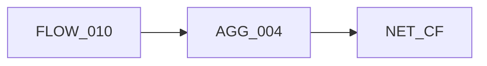

# prophet-vault

**Turn a Prophet actuarial model into a searchable, linked, diffable knowledge base.**

[](#testing)
[](pyproject.toml)
[](LICENSE)

English | [简体中文](README.zh-CN.md)

---

Prophet models live in a binary workspace: a Firebird database (`PROPHET.PRW`) plus
assorted index files. You can run the model, but you cannot search it. Questions that
should take ten seconds take an afternoon:

| Question | Without this toolkit | With this toolkit |
|---|---|---|
| "What does `NET_CF` actually calculate?" | Open Prophet, find the variable, read the formula | Search the vault, one click |
| "If I change `DUR_M`, what breaks?" | Nobody knows until the run fails | Dependency graph, one click |
| "What changed since last month's model?" | Binary files; `diff` is useless | Structured change report |
| "Which library does this variable belong to?" | Browse nine libraries by hand | Listed on the page |

This repository is the reusable part of a tool built for that problem. It reads a
Prophet workspace, takes a **versioned snapshot** of every variable, formula,
indicator and dependency, and renders that snapshot two ways:

* an **Obsidian vault** - one Markdown page per variable, with `[[wikilinks]]`,
  Mermaid graphs and Dataview queries, so a 15,000-variable model becomes browsable;
* a **single-file dependency graph** - a self-contained HTML page that renders the
  focused variable plus one to three hops of neighbours, which stays responsive where
  Obsidian's built-in graph view does not.

It was validated on a production model with roughly 15,000 variables, 26,000 formula
blocks and 985 indicators, and is meant to be reused for other Prophet workspaces and
adapted to other modelling platforms.

---

## Quick start (no Prophet needed)

The package ships a synthetic model generator so you can see every output in seconds:

```bash
git clone <this-repo> && cd prophet-vault
pip install -e .

python -m prophet_vault demo --out examples
```

That writes, under `examples/`:

```
examples/
├── snapshots/demo_2026-01/     # 146 variables, "last month"
├── snapshots/demo_2026-02/     # 148 variables, "this month"
├── diffs/demo_diff.json        # 3 added, 1 deleted, 1 formula change, ...
├── diffs/demo_diff_report.md   # human-readable change report
├── vault/                      # Obsidian vault - open this folder in Obsidian
└── dependency-graph.html       # open in any browser
```

Open `examples/dependency-graph.html`, type a variable name in the left panel, click
it, and you get its formulas, upstream and downstream dependencies. Everything shown
is fabricated demo data.

## Against a real Prophet workspace

```bash
# 1. Optional: check that the tool can see your database
python -m prophet_vault schema \
  --isql "C:/Prophet/ProphetServer/ProphetSuite/Firebird_3_0/isql.exe" \
  --prw  "D:/models/PROPHET.PRW"

# 2. Take a snapshot (this is the expensive step: minutes for 15k variables)
python -m prophet_vault snapshot \
  --isql "C:/Prophet/.../isql.exe" --prw "D:/models/PROPHET.PRW" --label 2026-08

# 3. Render it
python -m prophet_vault build-vault --snapshot output/snapshots/2026-08 --vault my_vault
python -m prophet_vault graph       --snapshot output/snapshots/2026-08 -o graph.html

# 4. Next month: snapshot again, diff, apply the delta to the existing vault
python -m prophet_vault snapshot     --prw "D:/models/PROPHET.PRW" --label 2026-09
python -m prophet_vault diff         --old output/snapshots/2026-08 --new output/snapshots/2026-09
python -m prophet_vault update-vault --diff output/diffs/latest_diff.json \
                                     --vault my_vault --snapshot output/snapshots/2026-09
```

Instead of passing `--isql` / `--prw` every time, set the environment variables
`PROPHET_ISQL_PATH`, `PROPHET_PRW_PATH` and (optionally) `PROPHET_WORKSPACE_DIR`,
`PROPHET_ISQL_USER`, `PROPHET_ISQL_PASS`.

The tool only ever **reads** the model. It never writes to a `.PRW`, never starts
Prophet, and needs no Prophet licence - `isql.exe` is a plain Firebird client that
ships with the installation.

## What a page looks like

`vault/Variables/Conventional/A/AGG_004.md` (from the demo model):

````markdown
---
name: AGG_004
description: "Aggregated result 4 (redefined for the new reporting basis)"
datatype: 0
num_dimensions: 0
is_array: 0
library: Conventional
tags: [variable]
version_history:
  - date: "2026-03-01"
    change: "DESCRIPTION_CHANGED"
---

# AGG_004

> Aggregated result 4 (redefined for the new reporting basis)

## Definition

```prophet
IF t = 0 THEN
  FLOW_024 + FLOW_010
ELSE
  FLOW_045(t-1) * (1 + FLOW_035) + FLOW_024
```

## Indicators
- [WITH_PROFIT](../../../Indicators/WITH_PROFIT.md)

## References
- [[FLOW_010]]
- [[FLOW_024]]

## Referenced by
- [[AGG_009]]
- [[NET_CF]]

## Dependency graph


````

## How it works

```
   Prophet workspace
   ┌───────────────────────────┐
   │ PROPHET.PRW (Firebird)    │──► isql.exe ──► fixed-width / BLOB parsers
   │ VAR_LIST.RCI (binary)     │──► binary scanner ──► variable descriptions
   └───────────────────────────┘
                 │
                 ▼
        snapshot/<label>/  ──►  variables.csv, formulas.csv, indicators.csv,
        (plain CSV + JSON)      references.csv, formula_hashes.csv, metadata.json
                 │
      ┌──────────┴───────────┐
      ▼                      ▼
  diff/<old>-vs-<new>.json   build-vault / graph
      │                      │
      ▼                      ▼
  update-vault          Obsidian vault, single-file HTML
```

A **snapshot** is plain CSV, so you can keep it in git, diff it by hand, load it in
pandas, or hand it to an auditor. A **diff** is plain JSON plus a Markdown report, so
a model change can go through review like any other change.

## Design notes

Short version; the reasoning is in [`docs/`](docs/).

* **`isql.exe` instead of a database driver.** A `.PRW` is an *embedded* Firebird
  database, and Prophet versions ship different on-disk formats. A Python driver links
  against one client library and breaks on the others; the `isql.exe` inside the
  installation always matches. See [docs/prw-extraction.md](docs/prw-extraction.md).
* **References are extracted as *candidates*, then intersected with the real variable
  list.** This is a tokeniser, not a Prophet parser, and it does not need to be more:
  unknown identifiers and unlisted keywords disappear in the intersection.
* **Formulas are compared by a normalised hash, not by text.** Re-indenting a formula
  is not a model change; adding a term is.
* **Pages are re-rendered, never patched in place.** String surgery around `##`
  headings survives exactly until somebody edits a page by hand.
* **The graph renders a focus subgraph.** Above ~10,000 nodes, whole-model layouts are
  unusable; one node plus N hops is instant. See
  [docs/dependency-graph.md](docs/dependency-graph.md).
* **Folders split by library, then by initial.** 15,000 files in one folder is hostile
  to Obsidian, Explorer and git.

## Repository layout

```
prophet_vault/            # the importable package, standard library only
├── cli.py                #   argparse CLI (python -m prophet_vault)
├── config.py             #   paths + credentials, env-var overridable
├── _io.py                #   UTF-8 / LF-stable writers (reproducible artefacts)
├── rci.py                #   VAR_LIST.RCI binary parser
├── isql.py               #   isql subprocess + fixed-width / BLOB output parsers
├── extract.py            #   PRW queries -> model data, reference derivation
├── formulas.py           #   tokeniser, reserved words, formula hashing
├── snapshot.py           #   the CSV snapshot contract
├── diff.py               #   snapshot comparison + reports
├── vault.py              #   Obsidian rendering and incremental updates
├── graph.py              #   HTML dependency graph
├── demo.py               #   synthetic model generator
└── templates/dependency_graph.html
tests/                    # 120 tests, no network, no Prophet install
examples/                 # generated demo snapshot, diff and graph
docs/                     # design and reference documentation
```

## Testing

```bash
pip install -e ".[dev]"
pytest
```

The suite runs offline and never touches a Prophet installation: the demo generator
provides model data, and the `isql` parsers are tested against recorded output shapes.

## Limitations and scope

* Targets **Prophet** (FIS). Table and column names are not a public API; if your
  version differs, run `python -m prophet_vault schema` and adjust the SQL constants in
  [`prophet_vault/extract.py`](prophet_vault/extract.py). The rest of the pipeline -
  snapshot, diff, vault, graph - is model-agnostic.
* Parsers are **heuristic**, not format specifications. `VAR_LIST.RCI` records have no
  stored length, and `isql` wraps wide values. Both are documented, both are tolerant,
  neither is byte-exact.
* **Windows-first**: Prophet servers are Windows, and `isql.exe` is invoked directly.
  The rest of the code is platform-neutral.
* Not a calculation engine. It documents and compares a model; it does not run one.

## Documentation

| Document | Contents |
|---|---|
| [architecture.md](docs/architecture.md) | Data flow, module boundaries, extension points |
| [data-model.md](docs/data-model.md) | The snapshot CSV/JSON contract |
| [prw-extraction.md](docs/prw-extraction.md) | Reading a Firebird `.PRW` through `isql` |
| [rci-format.md](docs/rci-format.md) | The `VAR_LIST.RCI` binary layout and parser strategy |
| [dependency-graph.md](docs/dependency-graph.md) | Graph data contract and rendering choices |
| [obsidian-vault.md](docs/obsidian-vault.md) | Vault layout, frontmatter, Dataview, Mermaid |
| [monthly-update.md](docs/monthly-update.md) | The snapshot/diff/update operating procedure |
| [troubleshooting.md](docs/troubleshooting.md) | Login failures, encoding, truncation, links |

## Contributing

Issues and pull requests are welcome - especially parser fixes for Prophet versions we
have not seen, and adapters for other modelling platforms (the snapshot contract is the
only thing an adapter has to produce). See [CONTRIBUTING.md](CONTRIBUTING.md).

## Credits

The code originated in an internal actuarial tool and was written with **Claude Code**
(the VS Code AI coding agent): the `isql`-based PRW extraction, the `VAR_LIST.RCI` reverse
engineering, the vault generator and the HTML dependency graph were all produced that way,
iteratively, against a live Prophet workspace.

This public repository - the package restructure, the removal of model-specific code, the
offline test suite, the synthetic demo generator and the documentation - was assembled with
**DeepSeek Harness**.

Both are AI coding agents used by an actuary who specified, reviewed and accepted the work;
the design decisions and their rationale are recorded in [`docs/`](docs/).

See [CONTRIBUTORS.md](CONTRIBUTORS.md) for the split of roles.

## License

MIT - see [LICENSE](LICENSE).

Prophet is a trademark of its owner. This project is independent and unofficial: it is
not affiliated with, endorsed by, or supported by the vendor. It reads files you already
have, on your own machine, and ships no vendor code.
